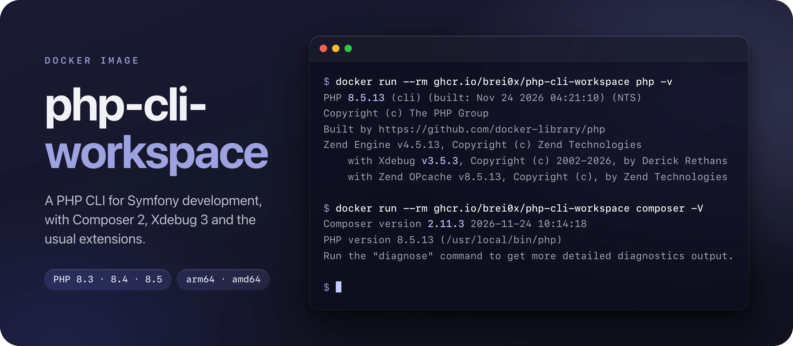

<p align="center">
  
</p>

# php-cli-workspace

PHP CLI Docker image for Symfony development, published for **PHP 8.3, 8.4 and 8.5** on **`linux/arm64` and `linux/amd64`** (Docker pulls only the platform matching your machine).

<p align="center">
  <a href="https://github.com/brei0x/php-cli-workspace/actions/workflows/publish.yml"></a>
  <a href="https://github.com/brei0x/php-cli-workspace/releases/latest"></a>
  <a href="https://github.com/brei0x/php-cli-workspace/blob/main/LICENSE"></a>
</p>

---

**Stack**: Docker · PHP on Debian Trixie (`php:*-cli-trixie`) · Composer 2 · Xdebug 3 · GitHub Container Registry · GitHub Actions

## Documentation

| Doc | Content |
| --- | --- |
| [docs/SETUP.md](docs/SETUP.md) | Usage, updating, other platform, Xdebug and JetBrains setup, local build, pipeline |
| [Releases](https://github.com/brei0x/php-cli-workspace/releases) | Dockerfile versions (`vX.Y.Z`) and their changes |
| [Security policy](https://github.com/brei0x/php-cli-workspace/security/policy) | How to report a vulnerability; served by `brei0x/.github` |
| [CLAUDE.md](CLAUDE.md) | Project context for Claude Code: pipeline internals, version policy, extensions |

## Quick start

Requires **Docker** (or any OCI runtime).

```bash
docker pull ghcr.io/brei0x/php-cli-workspace:latest
docker run --rm -it -v $(pwd):/app ghcr.io/brei0x/php-cli-workspace php bin/console list
```

Xdebug is off by default: run with `-e XDEBUG_MODE=debug` to step-debug. IDE setup and the other recipes are in **[docs/SETUP.md](docs/SETUP.md)**.

## What's included

- PHP 8.3, 8.4 or 8.5 (Debian Trixie)
- Composer 2
- Xdebug 3 (mode `off` by default; `client_host=host.docker.internal`, `client_port=9003`, `idekey=PHPSTORM`)
- Extensions: `bcmath` `bz2` `curl` `exif` `fileinfo` `gd` `intl` `mbstring` `opcache` `openssl` `pcntl` `pdo_mysql` `pdo_pgsql` `pgsql` `sodium` `sockets` `xsl` `zip`

## Commands

```bash
docker build -t php-cli-workspace .                                       # Build the default version (PHP 8.5)
docker build --build-arg PHP_VERSION=8.3 -t php-cli-workspace:8.3 .       # Build a specific version
docker run --rm php-cli-workspace php -m                                  # List the extensions, as CI does
```

## Environments

| Branch | Registry                                | Tags                                      |
| ------ | --------------------------------------- | ----------------------------------------- |
| `main` | `ghcr.io/brei0x/php-cli-workspace`      | `latest` (8.5), `8.5`, `8.4`, `8.3`       |

Publishing is **automatic** on every push to `main`, which also tags the commit and publishes its GitHub release. Every tag is rebuilt each Monday to pick up PHP and Debian security patches. Pipeline details: [docs/SETUP.md](docs/SETUP.md#pipeline).

## Workflow

One branch per task (`feat/…`, `fix/…`, `chore/…`), Conventional Commits, PRs target `main`. Before pushing:

```bash
docker build -t php-cli-workspace . && docker run --rm php-cli-workspace php -m
```
